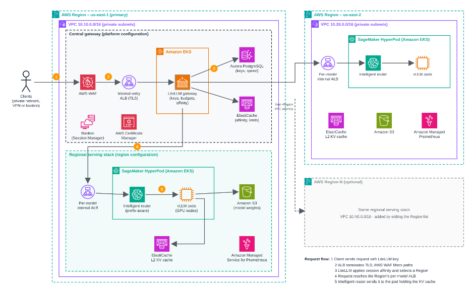

# Architecture

> **Sample / non-production.** This code accompanies a blog post and demonstrates a reference
> architecture. It is not production-ready and must not be deployed to production without additional
> security testing and hardening.

Multi-region AI inference on Amazon SageMaker HyperPod, fronted by a single **central LiteLLM** gateway in
the primary region. The gateway is the single private entry point; it load-balances each model across **one
HyperPod cluster per region**. HyperPod is fully private, and so is the entry ALB (`scheme=internal`) —
public exposure is left to the reader. The gateway reaches remote regions over **cross-region VPC peering**
(a star: primary to each region; regions never talk to each other).

## Topology

## Request flow

1. A client reaches the **internal entry ALB** privately (SSM bastion port-forward, VPN, or reader-added
   exposure) and presents a virtual key. To pin a conversation to its warm region, the client sends the
   **same** session id on **every** turn — the `x-litellm-session-id` header (or `x-litellm-trace-id` /
   `metadata.session_id` in the body, all equivalent). Omitting it makes each call a new session.
   Affinity pins are shared across LiteLLM replicas via the state Redis (TLS-required), so affinity works
   only while that Redis is reachable.
2. The ALB terminates **TLS** (reader-supplied or self-signed cert); the regional **WAFv2** WebACL allows
   `/v1/*` across the private network and restricts `/ui` to the primary VPC CIDR + admin CIDRs.
3. The **central LiteLLM** validates the key, applies per-team budgets/rate limits, and selects a region:
   **session affinity** pins the conversation to the region that served its first request (keeping that
   region's KV cache warm); for a new session (or if the pinned region is in cooldown) the
   `routing_strategy` (`least-busy`) picks a region and `cooldown_time`/`allowed_fails`/`num_retries` shed
   and fail over on errors. The pin is kept, so a recovered region reclaims its sessions.
4. LiteLLM dials that region's **per-model internal ALB** (`https://<model-alb>/v1`) — in-VPC for the primary,
   over **VPC peering** for other regions — injecting the model-ALB **gateway token** (see below) so the ALB
   admits the call.
5. The region's **Intelligent Router** does **prefix/KV-aware** routing to the right vLLM pod (L1 in-node +
   L2 Redis cache, local to the region). HyperPod-managed Karpenter scales GPU nodes.

## Layers -> modules / roots

| Layer | Module(s) / root |
|---|---|
| Remote state backend | `environments/00-bootstrap` |
| Per-region root (VPC + cluster + serving + model ALBs + SSM discovery) | `environments/region` |
| Platform root (central gateway + entry ALB + peering, primary region) | `environments/platform` |
| Network (VPC, subnets, route tables, endpoints) | `modules/regional-network` |
| Compute (EKS + HyperPod cluster, roles) | `modules/eks-hyperpod` |
| Cluster add-ons (operator, CSI, cert-manager, LB controller) | `modules/hyperpod-addons` |
| Autoscaling NodePools (GPU / system) | `modules/node-pools` |
| Model serving + per-model internal ALB | `modules/inference-endpoints`, `modules/regional-stack` |
| Model weights (per-region S3, no replication) | `modules/model-storage` |
| Weight ingestion (HF / S3) | `modules/model-ingestion` |
| L2 KV cache Redis (per region) | `modules/kv-cache-redis` |
| Cross-region VPC peering (star) | `modules/region-peering` |
| Central gateway (LiteLLM) + RBAC seed | `modules/litellm`, `modules/litellm-rbac` |
| Central gateway state (single Aurora + Redis) | `modules/litellm-state` |
| SSM bastion (test host) | `modules/jumpbox` |
| Observability (AMP per region; central Grafana = opt-in `enable_grafana`, needs IAM Identity Center) | `modules/observability`, `modules/observability-global` |

## Routing ownership (no duplication)

- **LiteLLM session affinity** — pins a conversation to the region that served it so that region's KV/prefix
  cache stays warm (cache is per-region and cannot cross regions). Runs **before** the routing strategy.
- **LiteLLM routing strategy** (`least-busy`) — places only **new** sessions across regions and handles
  spill/failover (`cooldown_time` / `allowed_fails` / `num_retries`).
- **HyperPod Intelligent Router** (`prefixaware`) — within a region, routes each request to the pod holding
  its KV/prefix cache (L1 in-node + L2 Redis).

## Securing the per-model ALBs (gateway token)

The per-model ALBs are `scheme=internal`, but "internal" only means *inside the VPC*. Their security group
admits the whole local + primary VPC CIDR (the central LiteLLM reaches them over VPC peering, and cross-region
peering does **not** support security-group references, so the rule has to be CIDR-based). The vLLM backend
behind the ALB does **no authentication** of its own. On CIDR rules alone, **any** pod, node, or instance in
those VPC CIDRs could call a model ALB directly and get inference — bypassing LiteLLM's virtual keys, budgets,
and rate limits entirely. LiteLLM's auth guards the *entry* ALB, not the *model* ALBs.

To close that gap, each model ALB admits a request only if it carries a shared secret header
(`x-model-gateway-token` by default) that the central LiteLLM injects on every upstream call
(`litellm_params.extra_headers`). The ALB listener rule matches the header via an annotation-based action +
condition; requests without a valid token fall through to the ALB default action (fixed **404**). Because the
model ALB terminates **TLS** (self-signed or a real ACM cert), the token is not exposed on the wire.

Token lifecycle: the `region` root generates the active token (`random_password`, keyed on
`gateway_token_version`), the ALB listener rule is programmed with it, and it is published to the primary
region's SSM as a **SecureString** (`/hpinf/regions/<region>/model_gw_token`). The `platform` root reads it
and passes it to LiteLLM per region deployment.

> **Trust model (be explicit).** This is a *bearer* secret: knowledge of the token grants access. It stops an
> unauthenticated in-VPC caller, but the value is visible to anyone who can read the ALB listener rule
> (`elasticloadbalancing:DescribeRules`) or the LiteLLM pod config. It is **not** cryptographic proof of
> identity. With the self-signed model-ALB cert (`model_upstream_ssl_verify = false`) the channel is encrypted
> but not authenticated, so an active in-VPC man-in-the-middle could still intercept the token — use a real
> ACM cert and set `model_upstream_ssl_verify = true` to remove that. For stronger per-caller identity, front
> the model ALBs with mTLS or SigV4/OIDC at the backend (out of scope for this sample).

**Zero-downtime rotation (dual token).** The ALB accepts **any** token in
`[active] + additional_accepted_gateway_tokens`, so you can overlap old and new during a rotation:

1. Note the current (old) token (SSM param / region output).
2. Set `additional_accepted_gateway_tokens = [<old token>]` **and** bump `gateway_token_version` on the
   `region` root, then re-apply it. The ALB now accepts **both** old and new; LiteLLM is still sending old.
3. Re-apply the `platform` root — LiteLLM switches to the new token (both still valid at the ALB, so no
   request is rejected mid-rotation).
4. Clear `additional_accepted_gateway_tokens` back to `[]` and re-apply the `region` root. The ALB now
   accepts only the new token.

Skipping the overlap (just bumping `gateway_token_version` and re-applying both roots) rotates with a brief
window where in-flight calls carrying the old token are 404'd, so prefer the dual-token steps when you need
no downtime.

## Discovery + connectivity

- Each `region` root publishes to the **primary** region's SSM under `/hpinf/regions/<region>/`: the model
  ALB DNS map, `vpc_id`, `vpc_cidr`, `private_route_table_ids`, `amp_arn`, and the `model_gw_token`
  (SecureString; the gateway token above).
- The `platform` root reads that path (plus the primary region root's remote state for the cluster/VPC
  details it attaches to), builds one LiteLLM deployment per discovered+enabled region, and creates
  **cross-region VPC peering** (requester in the primary, accepter via a per-region `aws` provider alias,
  routes on both sides). Only the primary reaches the regions; the regions do not reach each other.
